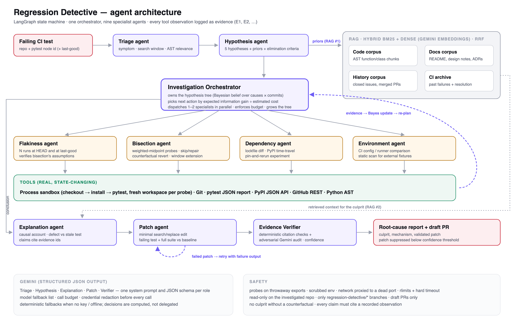
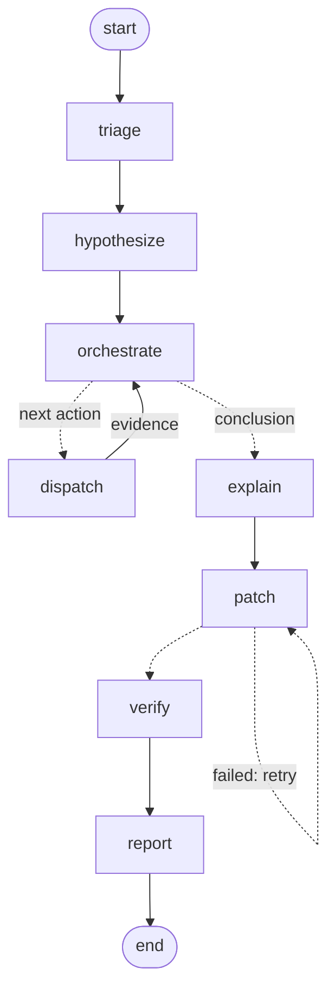
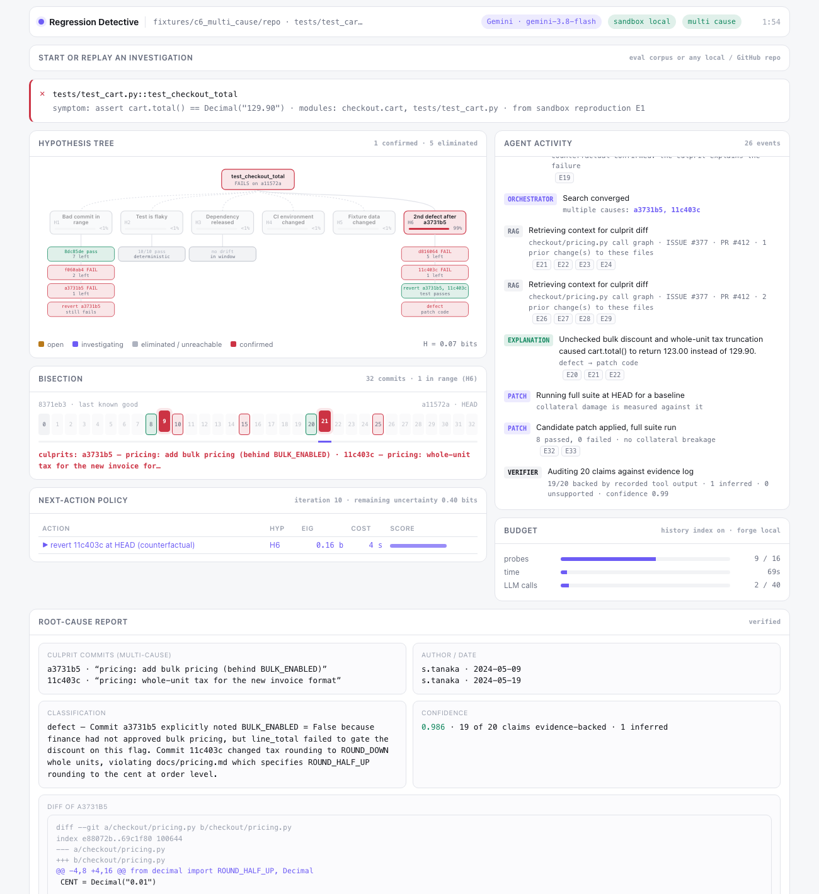
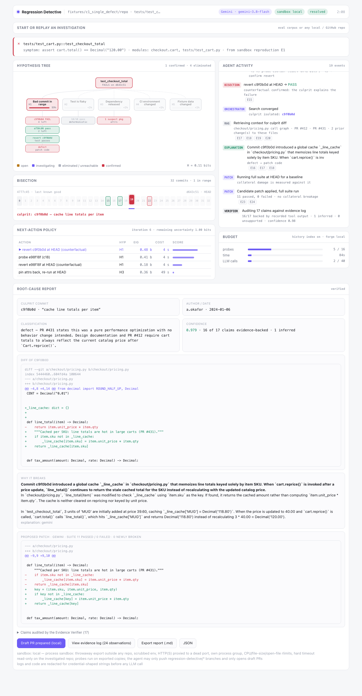

# FA Activity Submission — Agentic AI Application Implementation

## A. Title

**Regression Detective: An Autonomous Agent for Root-Cause Diagnosis of CI Test Regressions**

Domain: Software Development Assistant · Technology: Python, LangGraph, Gemini API, RAG (hybrid BM25 +
Gemini embeddings), FastAPI

---

## B. Architecture Diagram



**How to read it.** A failing test enters at the top left. The **Triage** agent turns the failure into a
symptom signature and a search window of commits. The **Hypothesis** agent proposes five competing
explanations and seeds their probabilities from similar past failures (retrieval point 1).

The **Investigation Orchestrator** holds these hypotheses as a probability distribution and repeatedly picks
the experiment with the best *expected information gain per second*. It dispatches one or two specialist
agents (Flakiness, Bisection, Dependency, Environment). These run real experiments through the tools,
mainly checking out a commit, installing it and running the test.

Every result flows back to the orchestrator (dashed purple edge). It updates the beliefs with Bayes' rule
and plans the next experiment. When a cause is confirmed by a counterfactual experiment, the **Explanation**
agent explains the mechanism using retrieved code, docs and PR history (retrieval point 2). The **Patch**
agent proposes and validates a fix, retrying with the failure output if it doesn't hold. The **Evidence
Verifier** checks every claim against recorded tool output before the report is shown.

The same graph, generated directly from the code (`python -m detective graph`):



---

## C. Working Application

The application is a web UI plus a command line, both driving the same agent.

**Run it**

```bash
git clone https://github.com/diya1411/regression-detective && cd regression-detective
python3.12 -m venv .venv && source .venv/bin/activate
pip install -r requirements.txt
echo "GEMINI_API_KEY=<your key>" > .env     # optional: without it, deterministic fallbacks are used
python -m eval.build_fixtures               # builds the 8 test repositories
python -m detective serve                   # open http://127.0.0.1:8000
```

In the UI, choose an eval case (or enter any local repository and failing test) and press **Investigate**.
Everything updates live:

- the hypothesis tree, with probabilities, eliminated branches and new hypotheses as they appear
- the commit strip, as bisection narrows the range
- the orchestrator's scoring of candidate actions
- an agent activity feed, where every entry links to the raw tool output behind it

Any past investigation can be replayed.

**Live investigation** (eval case 6, two independent defects, Gemini on):



**Root-cause report** (eval case 1, Gemini on). Gemini explains the stale-cache mechanism and proposes a
patch that keys the cache by `(sku, price, qty)`. The patch passed the full test suite in the sandbox:



Command-line equivalent:

```bash
python -m detective investigate --repo <path or GitHub URL> --test tests/test_x.py::test_y --last-good <sha>
python -m detective trace last        # the orchestrator's decision trace, with information gain and cost
```

---

## D. Source Code

**GitHub:** https://github.com/diya1411/regression-detective

| Folder | Contents |
|---|---|
| `detective/agents/` | orchestrator + 9 specialist agents; all prompts and JSON schemas in `prompts.py` |
| `detective/belief.py`, `policy.py` | hypothesis tree as a probability distribution; likelihood models and the information-gain ÷ cost policy |
| `detective/graph.py` | LangGraph state machine (two feedback loops) |
| `detective/rag/` | four corpora; hybrid BM25 + dense retrieval with reciprocal rank fusion |
| `detective/tools/` | Git, GitHub REST, PyPI JSON API, pytest JSON report, Python AST |
| `detective/sandbox/` | process sandbox: throwaway checkout, cached virtualenvs, resource limits |
| `detective/server/`, `ui/` | FastAPI + Server-Sent Events backend; live UI |
| `eval/` | ground-truth test corpus builder and automatic scorer |
| `tests/` | 26 unit and end-to-end tests |
| `docs/` | architecture details, test report, this submission, short report |

---

## E. Test Report

### Method

Each test case is a git repository generated with a defect, or a deliberate non-defect, at a **known
commit**. The correct answer is therefore known in advance, and the agent's report is scored automatically
(`python -m eval.run_eval`). No human judgement is involved.

### Test cases

| # | Test case | Input | Expected behaviour | Pass criterion |
|---|---|---|---|---|
| TC1 | Single defect commit | 32-commit window; commit 19 caches line totals per item, so totals go stale after a price change | Bisect, isolate, confirm, explain, patch | Correct commit; classified *defect*; ≤ 6 probes |
| TC2 | Genuinely flaky test | Test depends on set-iteration order, which changes between runs; no regression | Detect flakiness and stop early | Reports *flaky*; never starts bisection |
| TC3 | Dependency release | Unpinned package `rdfixture-money` released 1.1.0 inside the window (changes rounding); code unchanged | Pin-and-rerun experiment | Names the package; "bad commit" hypothesis eliminated; no commit blamed |
| TC4 | Unbuildable neighbours | Culprit sits next to a commit with a broken dependency pin and one with a syntax error | Skip or repair unbuildable commits | Correct commit despite skips |
| TC5 | Intentional change, stale test | Rounding switched to banker's rounding by design (ADR-0007); test still expects the old value | Distinguish stale test from defect using retrieved docs/PRs | Correct commit; classified *stale test*; fix the test, not the code |
| TC6 | Two independent defects | Commits 9 and 21 each break the same test | Detect that one commit doesn't explain everything | Both commits named; status *multi-cause* |
| TC7 | Wrong search window | CI wrongly reported a later commit as last-good; the real culprit is older | Detect the invalid window | *Window invalid*; no false culprit named |
| TC8 | Budget exhausted | 64-commit window with a budget of only 3 probes | Stop gracefully | *Budget exhausted*; no culprit named; true culprit inside the reported range |

### Results with Gemini (live API)

| # | Result | Culprit(s) found | Classification | Probes (log2 min) | Confidence | Status |
|---|---|---|---|---|---|---|
| TC1 | resolved | c9f0b0d | defect | 4 (5) | 0.979 | ✅ Pass |
| TC2 | flaky | – | – | 0 | 0.970 | ✅ Pass |
| TC3 | dependency (`rdfixture-money` 1.0.0 → 1.1.0) | – | dependency change | 0 | 0.970 | ✅ Pass |
| TC4 | resolved | 21c4b37 | defect | 3 (4) | 0.975 | ✅ Pass |
| TC5 | resolved | 3dab4ac | stale test | 3 (4) | 0.975 | ✅ Pass |
| TC6 | multi-cause | a3731b5, 11c403c | defect | 7 (two searches) | 0.986 | ✅ Pass |
| TC7 | window invalid (test passes 8 commits before the given last-good) | – | – | 0 | 0.940 | ✅ Pass |
| TC8 | budget exhausted (narrowed to 8 commits) | – | – | 3 | 0.600 | ✅ Pass |

**Summary:** 8/8 passed · **false-confidence rate 0%** (no wrong answer at confidence ≥ 0.7) · 0 wrong
commits blamed · 0 claims rejected by the verifier · mean time 102 s per investigation with Gemini.

The same 8 cases also pass 8/8 in offline mode (no LLM, ~8 s each) and with the retrieval history index
disabled, so the core reasoning doesn't depend on the LLM.

**Observation on TC5:** in the Gemini run, the free-tier quota ran out at the patch step, and the
non-LLM fallback reverted the code. That is the wrong fix for an intentional change. This was corrected:
the fallback now updates the test's expected value (`121.01 → 121.00`) and never reverts an intended
change. Re-running TC5 through that fallback path passed with the test updated, not the code reverted.

### Automated tests

26 unit and integration tests (`pytest`), all passing. They cover the probability maths and action
selection, retrieval ranking, diff parsing, dependency discovery, credential redaction, Gemini error
handling (model fallback, exhausted quota), and complete end-to-end investigations, including one with the
LLM path enabled.

Full details: [docs/test-report.md](test-report.md).

---

## F. Short Report

Submitted separately: [docs/REPORT.md](REPORT.md).
