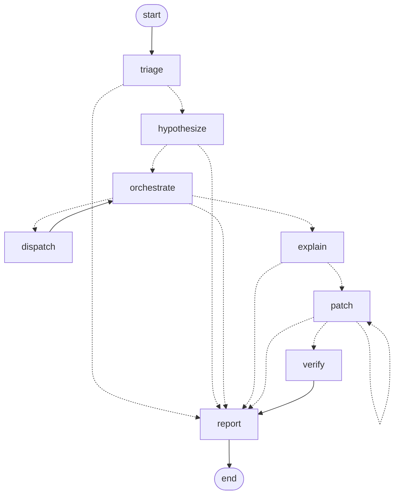

# Architecture

## 1. Agent graph (generated from code)

`python -m detective graph` prints this from the compiled LangGraph, so the diagram cannot drift from the
implementation. Dashed edges are conditional.



There are two feedback edges, which is what makes this agentic rather than a pipeline:

- `dispatch → orchestrate`: every sandbox result re-plans the next action.
- `patch → patch`: a patch that fails the test, or breaks another test, goes back to the Patch agent with
  the failure output (at most 3 attempts).

Every node is wrapped so that an exception routes to `report` with `status=error` instead of crashing.

## 2. Static topology

```
 CI failure (test id, repo)
        │
        ▼
 Triage ──────────────► sandbox: reproduce at HEAD · git: window · AST: import closure → relevance prior
        │
        ▼
 Hypothesis ──────────► RAG point 1: similar failures in the CI archive → priors (+ Gemini tailoring)
        │
        ▼
 ┌─► Orchestrator  (owns the belief, the budget and the policy; never touches a tool)
 │      │ dispatch (1–2 actions in parallel)
 │      ▼
 │   Flakiness · Bisection · Dependency · Environment ──► Docker sandbox / PyPI / git / CI / AST
 │      │ evidence (EvidenceLog ids)
 └──────┘
        │ conclusion (confirmed, budget exhausted, or no informative action left)
        ▼
 Explanation ─────────► RAG point 2: touched functions, covering tests, design docs, PRs on the same files
        ▼
 Patch ⟲ ─────────────► sandbox: failing test + full suite vs. HEAD baseline
        ▼
 Evidence Verifier ───► deterministic citation/field checks + adversarial Gemini audit
        ▼
 Report (JSON + Markdown) + draft PR proposal
```

## 3. The hypothesis tree as a distribution

The belief ([belief.py](../detective/belief.py)) is a distribution over **leaves**:

- `(H, ·)` for each non-commit hypothesis (flaky, dependency, environment, fixture, window), and
- `(H, c)` for every candidate commit `c ∈ (good, bad]` of a commit-kind hypothesis (H1, and a spawned
  "second defect").

`P(H1, c) = P(H1) · w_c / Σw`, where `w_c` is the AST relevance prior: 1.0 if the commit touches the failing
test's import closure, a dependency manifest or a conftest; 0.35 for other code; 0.6 for data/config; 0.08
for documentation only. Low weight shifts the bisection midpoint; it never removes a commit.

Entropy is computed over all leaves, so one number covers both "which kind of cause" and "which commit".

**Update.** Each action has a likelihood `P(outcome | leaf)` ([policy.py](../detective/policy.py)). After an
observation the posterior is `P(leaf | o) ∝ P(o | leaf) · P(leaf)`. Bisection verdicts additionally prune the
candidate interval (the monotonicity assumption), with `ε = 0.01` covering a mis-recorded verdict.

**Status.** A hypothesis is *eliminated* when `p < 0.02`. It is *unreachable* instead when the decisive
evidence was static analysis, i.e. argued rather than tested. It is *confirmed* only when `p ≥ 0.9` **and**
its confirmation experiment has succeeded:

| kind | confirmation experiment |
|---|---|
| commit | reverting the culprit at HEAD makes the test pass |
| second defect | reverting both culprits at HEAD makes the test pass |
| dependency | pinning the suspect package(s) back makes HEAD pass at unchanged code |
| flaky | repeated runs give both passes and failures |
| window | an older ancestor of last-good passes |

**Spawning.** Two observations contradict an assumption the initial tree was built on, and each one adds a
hypothesis (taking 15% or 30% of the mass) before the update is applied:

- last-good fails in today's sandbox → **"Regression predates the window"**, tested by probing
  last-good~2, ~4, ~8, …
- the counterfactual revert does not fix HEAD, although `c−1` passes and `c` fails → **"Second defect after
  c"**, with its own interval `(c, HEAD]` and every probe applying the revert of `c`.

## 4. Next-action policy

For each available action `a` with outcomes `o`:

```
EIG(a)   = H(belief) − Σ_o P(o) · H(belief | o)
score(a) = EIG(a) / cost(a)
```

| action | agent | outcomes | notes |
|---|---|---|---|
| `flaky_check` | Flakiness | stable / head-intermittent / both-intermittent / last-good-fails / no-repro / last-good-unbuildable | N runs at HEAD and N at last-good, in parallel |
| `bisect_probe` | Bisection | pass / fail | at the relevance-weighted midpoint; only after endpoints are verified |
| `confirm_revert` | Bisection | pass / fail | counterfactual at HEAD; available once ≤ 3 candidates remain |
| `window_extend` | Bisection | pass / fail | only after the window hypothesis is spawned |
| `dep_diff` | Dependency | suspects / none | manifests + PyPI time-travel resolution at the last-good date |
| `dep_pin_test` | Dependency | pass / fail | pins suspects back at HEAD; isolates one package at a time on pass |
| `env_check` | Environment | changed / unchanged | CI config diff + runner metadata |
| `fixture_scan` | Environment | external / none | AST scan of the import closure for network / absolute-path reads |

**Cost model.** Start-up assumptions (45 s build, 2 s per run) are replaced by an exponential moving average
of measured build and run times. A probe whose dependency image is already cached costs no build time. This is
why the flakiness check (two cached images, 2×N fast runs) usually wins the first decision, and why the
dependency pin test is often dispatched in parallel with a bisection probe.

**Parallelism.** The best action is always chosen. A second action is added if it targets a different
hypothesis and scores at least 20% of the best.

**Termination.** The loop stops when a hypothesis is confirmed, or the probe or wall-clock budget is
exhausted (the report then lists the narrowed range), or no action has EIG above 0.001 bits (inconclusive).

### Likelihood model (excerpt)

`P(flakiness outcome | kind)`:

| kind | stable | head intermittent | both intermittent | last-good fails | no repro |
|---|---|---|---|---|---|
| commit | .93 | .03 | .005 | .02 | .01 |
| flaky | .10 | .25 | .55 | .02 | .075 |
| dependency | .30 | .03 | .01 | .55 | .06 |
| environment | .10 | .04 | .02 | .40 | .34 |
| fixture | .10 | .10 | .05 | .55 | .18 |
| window | .01 | .01 | .01 | .95 | .01 |

The reasoning behind the rows: if last-good passes and HEAD fails *in the same sandbox*, the difference must be
in the code, so drift hypotheses (dependency release, environment, external data) predict that both commits
fail alike. The same argument sets the window-extension likelihoods: an older commit passing in the same
sandbox is strong evidence against drift.

## 5. Retrieval

Four corpora ([rag/corpora.py](../detective/rag/corpora.py)):

| corpus | chunking | metadata | used by |
|---|---|---|---|
| code | AST function/class level at last-good; culprit files indexed incrementally | sha, path, qualname, is_test | Explanation |
| docs | per heading (README, docs/, ADRs) | sha, path, heading | Explanation |
| history | per issue/PR thread | number, files, linked commit | Hypothesis, Explanation |
| CI archive | per failure event | resolution, fix commit, test id | Hypothesis |

Ranking is hybrid ([rag/index.py](../detective/rag/index.py)): BM25 over identifier-aware tokens
(`line_total` → `line_total`, `line`, `total`; camelCase is split), plus dense cosine similarity (Gemini
`gemini-embedding-001` at 768 dimensions with an on-disk cache, or a feature-hashing fallback offline). The
two rankings are fused with reciprocal rank fusion (k = 60). The corpora hold thousands of chunks, not
millions, so exact numpy search is used instead of an ANN index.

- **Retrieval point one (priors):** similar past failures. Each hit adds `1/(rank+1)` to its resolution
  category, smoothed with α = 2 × base rates. The flakiness prior is ×0.6 if this test has no flake record
  and ×2 if it has one. `--no-history` disables this, which is the ablation in the test report.
- **Retrieval point two (explanation):** functions the diff touches (before and after, from precise
  changed-line ranges), tests covering them, design-doc sections, PRs/issues by text and by file overlap, and
  prior commits on the same files. Every retrieval is recorded as evidence, so the explanation can cite it.
  This is what separates a *defect* from a *stale test* (eval case 5: ADR-0007 declares banker's rounding
  intentional).

## 6. Evidence and events

- `EvidenceLog` holds every tool observation (`E1, E2, …`) with structured data, the full raw output on disk,
  and a kind: experiment, static, api, retrieval or derived. Claims cite these ids.
- `EventBus` is an append-only `events.jsonl`. The UI is a pure function of this stream, which gives live view
  and replay from the same code path.
- Every Gemini call (prompt, response, model, latency) is written to `llm/NNN-role.json`.
